# Hearthway Rehoming Network — EDA das adoções de primavera 2026

**Pergunta central:** que sinais de triagem e que falhas de registo impedem saber quais adoções duraram e porquê?

Este relatório acompanha o protótipo de registo partilhado entre a equipa de Adoptions e a equipa de Follow-up. O objetivo não é escolher um algoritmo, mas tornar visíveis os problemas de estrutura, identidade e estado que hoje limitam qualquer análise.

## Resumo executivo

- **24 candidaturas reais** em Responses (23 pessoas únicas), além de 2 linhas de teste; 1006 não existe, 1012 só aparece em final e 1016/1023 são a mesma Mark Shaw.
- **23 de 24** candidaturas reais têm estado preenchido; há 13 valores brutos de Status para 8 estados canónicos, incluindo desconhecido.
- **6 dos 12 IDs sobrepostos** têm estados diferentes: 4 são progressões (Waitlist/Reuse/Visit → Approved) e 2 são reversões (1022 e 1024, Approved → Waitlist). Só as reversões são contradições reais; as progressões são o ciclo de vida.
- As fórmulas da sheet Summary **não são uma fonte fiável de KPIs**: 83 células estão sem cache, 5 têm erro e a fórmula Approved conta 9 em vez de 10 aprovações canónicas.
- Os scores de screening não mostram separação limpa entre aprovados, waitlist e candidaturas sem `final`; 16 casos e estados sobrepostos não permitem estimar predictividade.
- **16 linhas de Follow-up** representam 14 adopters, 15 códigos de animal e 15 episódios de placement; 9 linhas não têm 1m/6m. DOG-0424 é a mesma Lola em fallback, não uma duplicação; DOG-0418 → DOG-0421 é uma troca.
- A ligação entre equipas é fraca no telefone (**2 de 14 adopters**), mas uma passagem determinística resolve **10 de 14**: 2 por telefone exato e 8 por nome + estado, duplicação de pessoa ou animais do agregado; um destes (Harry A.) é só uma correspondência única de nome, sem confirmação de estado. Fica 1 ambíguo (Sam A.) e 3 sem candidato (Pam Q., Oscar S., Ivy C.).
- **DOB não é uma chave segura:** 10 datas brutas diferem de dd/mm/yyyy; 1016 é validado pelo duplicado 1023 (1985-10-02), mas as outras nove continuam por auditar.

**Leitura principal:** o problema não é apenas “sujidade”. É a ausência de uma chave de pessoa estável, de um estado por equipa com timestamp e de uma coorte fechada de placements. Sem isso, os sinais de screening não podem ser avaliados de forma convincente. A inferência determinística resolve os casos em que os próprios ficheiros dão evidência suficiente; não substitui a revisão humana onde as fontes se contradizem.

A resposta à pergunta 2 do case — os cinco itens mais importantes e o tratamento proposto — está na secção final.

## Como reproduzir

```bash
uv run python -m data
```

A pipeline lê os ficheiros originais em modo read-only, reconstrói as tabelas derivadas em memória e escreve os artefactos em `outputs/`.

## Âmbito e denominadores

- `Responses` é a ficha de candidatura; as linhas 1000 e 1017 são testes e são excluídas dos KPIs.
- `final` parece ser a lista operacional de placements, mas inclui 1012, ausente em Responses; não é uma coorte fechada.
- `Follow-up` não tem IDs de candidatura nem ano nas datas. A ligação a Adoptions foi resolvida deterministicamente onde os ficheiros davam evidência suficiente; os casos restantes continuam a exigir confirmação.
- Nenhuma conclusão é causal: a amostra é pequena e o follow-up é incompleto.

## Linkage determinístico: o que os ficheiros já permitem decidir

A revisão não trata todos os pares como igualmente ambíguos. Foram aplicadas regras que um analista pode reproduzir sem perguntar a ninguém:

1. **Pessoa primeiro:** o mesmo número de adopter (ou nome + telefone + DOB) agrupa linhas. 1016 e 1023 são a mesma pessoa (Mark Shaw; adopter no. 060064440, telefone 07570 468615, DOB 1985-10-02).
2. **Estado depois:** um candidato `Rejected` ou `List B` perde para um candidato aprovado/in final com o mesmo nome + inicial.
3. **Pets só como desempate:** quando dois candidatos aprovados têm o mesmo nome + inicial, o tipo de animal do Follow-up pode desempatar (Hannah R. → 1005, que tem dois gatos; 1010 não tem gatos).
4. **Sem decisão forçada:** se nenhum candidato é aprovado/in final, ou se o desempate não é determinístico, o caso fica marcado como ambíguo.

| Follow-up | Leitura anterior | Resolução determinística | Evidência |
| --- | --- | --- | --- |
| Mark S. | 1011 Mark Singh (rejected) | **1016 Mark Shaw** | 1016/1023 são a mesma pessoa; 1016 está em final Approved. Mark Singh está Rejected. |
| Claire H. | 1004/1019 Claire Harrison (empate) | **1004 Claire Harrison** | 1004 Approved/in final; 1019 Rejected. |
| Lucy F. | 1001/1026 Lucy (empate) | **1001 Lucy Fisher** | 1001 Approved/in final; 1026 List B. |
| Danielle H. | 1014/1015 Danielle (empate) | **1015 Danielle Hughes** | 1015 Approved/in final; 1014 List B. |
| Hannah R. | 1005/1010 Hannah R. (empate) | **1005 Hannah Rowe** | Ambos aprovados/in final; só 1005 tem dois gatos, como o Follow-up. |
| Sam A. | 1003 Sam Ahmed | **mantém-se ambíguo** | 1003 Rejected - previous return; 1027 sem estado. Nenhum é aprovado/in final; as evidências apontam em direções diferentes. |
| Pam Q., Oscar S., Ivy C. | sem candidato | **sem candidato** | Não há nome/telefone correspondente; provavelmente outra coorte/centro ou registo em falta. |

O resultado é uma redução de 6 casos ambíguos para 1, sem esconder os candidatos descartados: a tabela T11 mantém as alternativas e o motivo. A mesma lógica corrige a leitura da data: o valor de 1016 (1985-10-02) não é um erro de dados, é confirmado pela linha 1023 em formato ISO. As outras nove datas divergentes continuam a precisar de auditoria.

## 1. EDA estrutural

### F01 — Campos com dados em falta por ficha

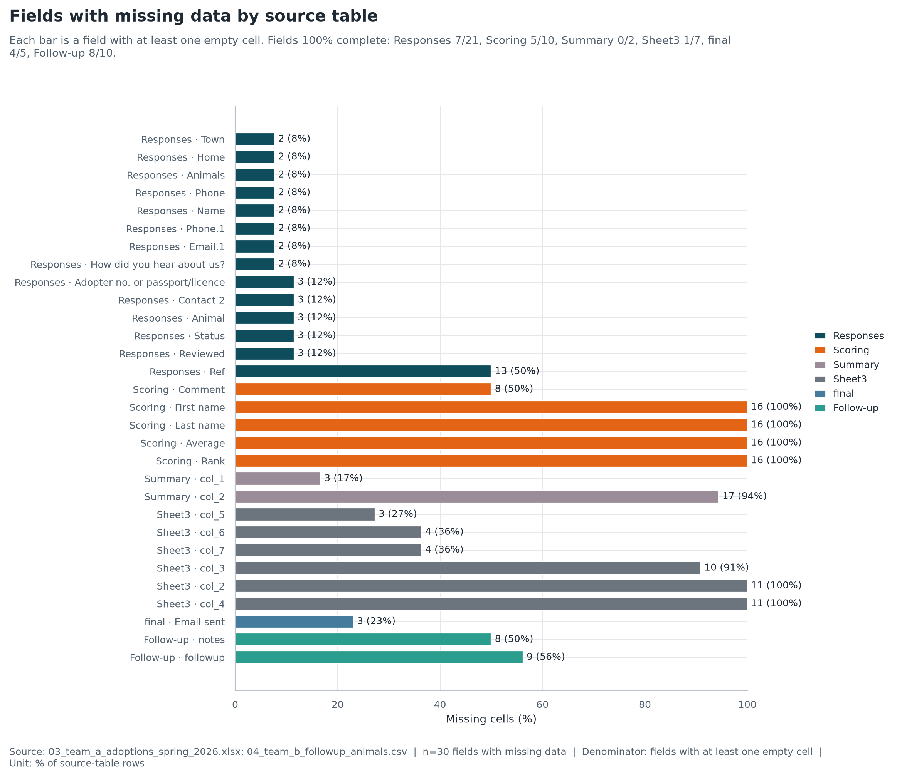

**Pergunta:** Onde estão os buracos e quais campos são críticos?

**Leitura:** Ref, comentários e follow-up são os campos mais vazios; a ausência é sobretudo estrutural, não aleatória.

**n / denominador:** 30 campos com missing / campos com pelo menos uma célula vazia.

**Fonte:** 03_team_a_adoptions_spring_2026.xlsx; 04_team_b_followup_animals.csv.

**Ressalva:** Campos 100% preenchidos não aparecem no gráfico; a tabela T03 contém o perfil completo.

### F02 — Formatos coexistentes em contacto, data e identidade

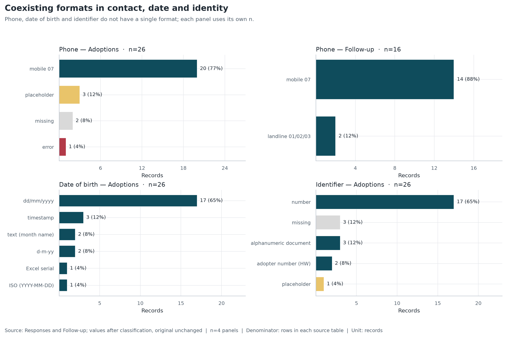

**Pergunta:** Que formatos convivem nestes campos-chave?

**Leitura:** O telefone aparece em cinco formatos; a data mistura dd/mm, ISO, texto e serial Excel; o identificador mistura quatro tipos.

**n / denominador:** 4 painéis / linhas de cada ficha.

**Fonte:** Responses e Follow-up; valores após classificação, sem alterar o original.

**Ressalva:** As categorias descrevem o valor observado, não uma correção do dado.

### F03 — Candidaturas por semana e estado

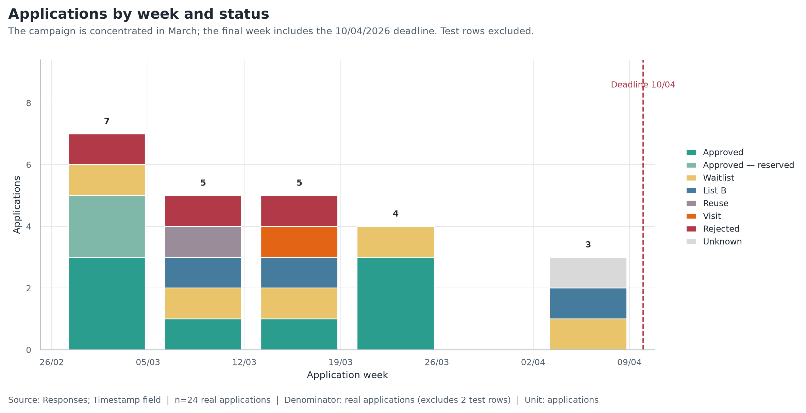

**Pergunta:** Como as candidaturas se distribuem no tempo?

**Leitura:** O volume cai ao longo da campanha; a última semana tem apenas três candidaturas e inclui o prazo.

**n / denominador:** 24 candidaturas reais / candidaturas reais (exclui 2 linhas de teste).

**Fonte:** Responses; campo Timestamp.

**Ressalva:** A semana é uma convenção de calendário, não um lote operacional.

## 2. Qualidade dos dados

### F04 — 13 valores brutos para 8 estados canónicos

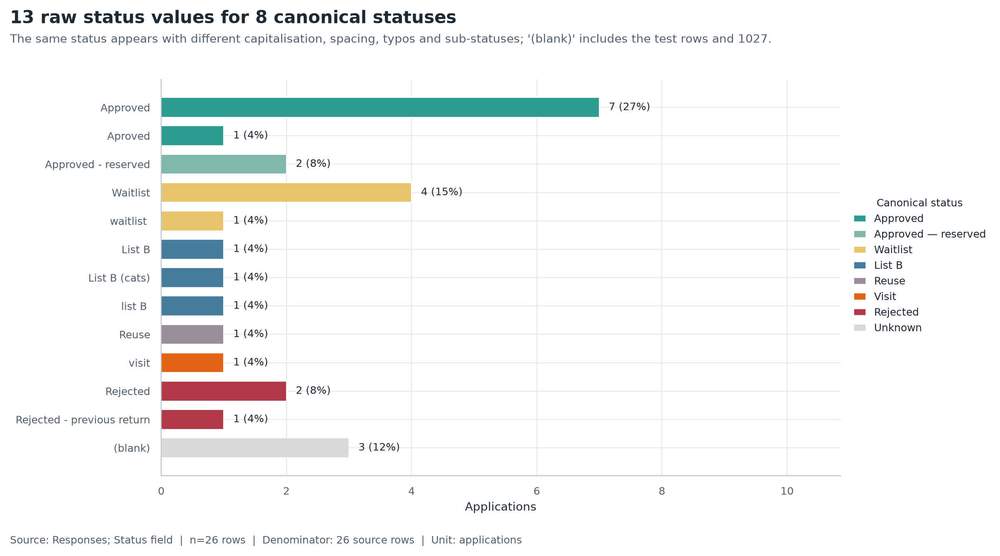

**Pergunta:** Quais variantes de estado existem e quanto pesam?

**Leitura:** Há 10 aprovações canónicas, mas a fórmula Summary conta 9; Lista B tem três variantes e só uma é apanhada pela fórmula.

**n / denominador:** 26 linhas / 26 linhas da ficha.

**Fonte:** Responses; campo Status.

**Ressalva:** A cor agrupa significado; o rótulo y preserva a grafia original.

### F05 — Cobertura por fonte e diferenças de estado

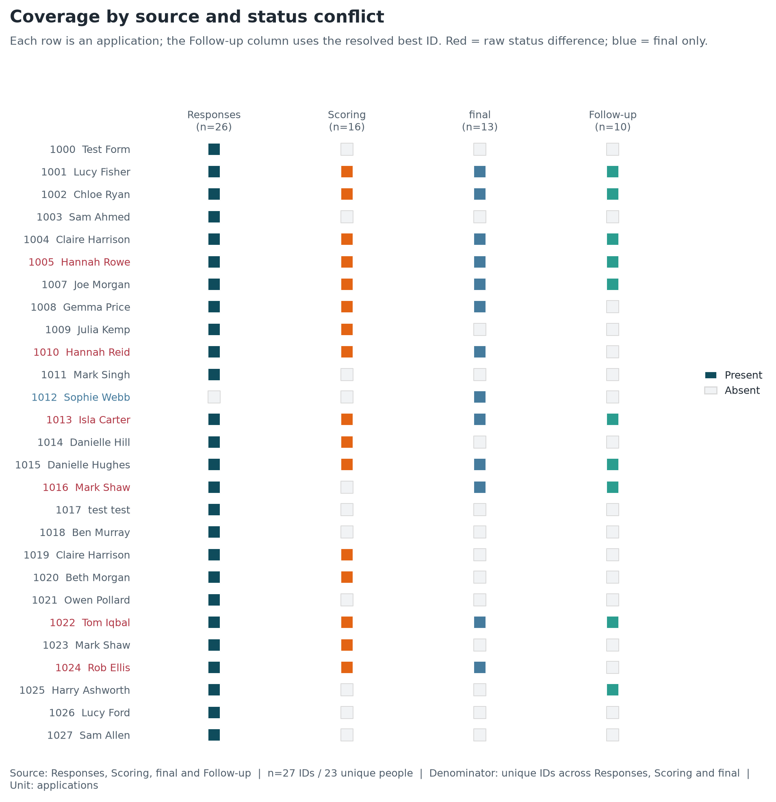

**Pergunta:** Que registos existem em cada fonte e onde há conflito?

**Leitura:** Há linhas só a montante (1009, 1018 e 1023, esta duplicada de 1016) e uma só a jusante (1012). Seis IDs sobrepostos têm estados diferentes: quatro progressões e duas reversões; só as reversões são contradições reais.

**n / denominador:** 27 IDs (23 pessoas únicas) / IDs únicos entre Responses, Scoring e final.

**Fonte:** Responses, Scoring, final e Follow-up.

**Ressalva:** A coluna Follow-up usa o melhor ID resolvido; Sam A. continua ambíguo e não é marcado.

### F06 — O parser difere de dd/mm/yyyy em 10 registos

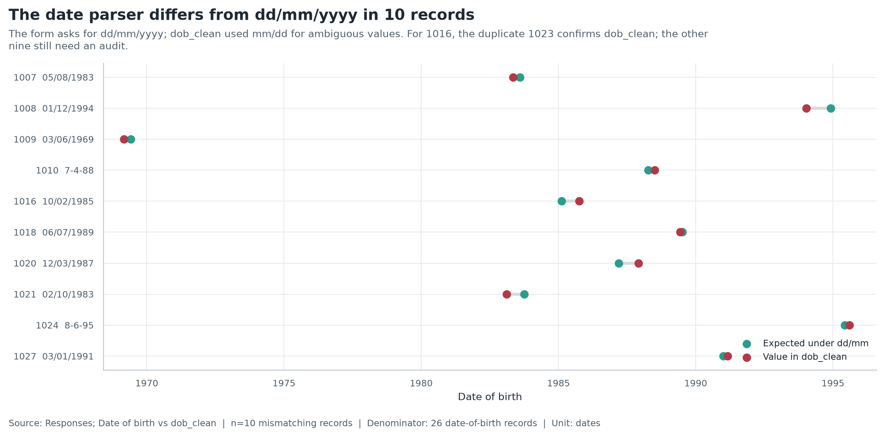

**Pergunta:** Onde a data de nascimento foi mal interpretada?

**Leitura:** Dez datas brutas diferem de dd/mm/yyyy. Para 1016, o duplicado 1023 confirma 1985-10-02, pelo que dob_clean está certo nesse caso; as outras nove continuam por auditar. Usar DOB como chave cega continua a produzir falsos negativos e positivos.

**n / denominador:** 10 registos divergentes / 26 registos de nascimento.

**Fonte:** Responses; Date of birth vs dob_clean.

**Ressalva:** A regra dd/mm/yyyy é a declarada no formulário, não prova da data correta.

## 3. EDA semântica

### F07 — Que evidência liga o Follow-up a Adoptions?

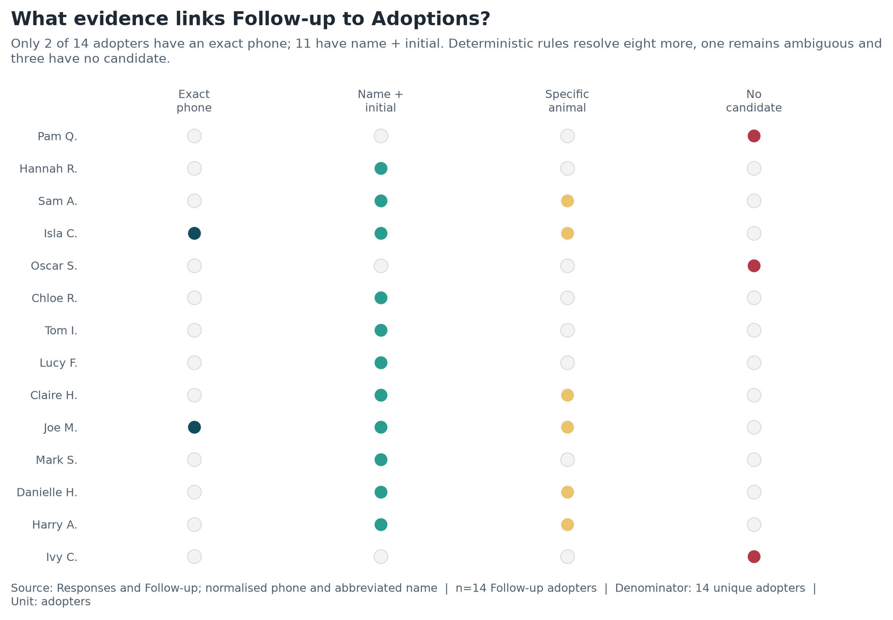

**Pergunta:** Que evidência existe para ligar as duas equipas?

**Leitura:** O telefone é raro e não chega; o nome+inicial está disponível em 11 casos, mas raramente é único. A passagem determinística resolve 10 de 14 (um deles, Harry A., só por nome único, sem confirmação de estado); 1 fica ambíguo e 3 não têm candidato.

**n / denominador:** 14 adopters do Follow-up / 14 adopters únicos.

**Fonte:** Responses e Follow-up; telefone normalizado e nome abreviado.

**Ressalva:** Animal específico é evidência fraca: nomes de animais repetem-se entre campanhas.

### F08 — Candidatos de linkage e ambiguidade

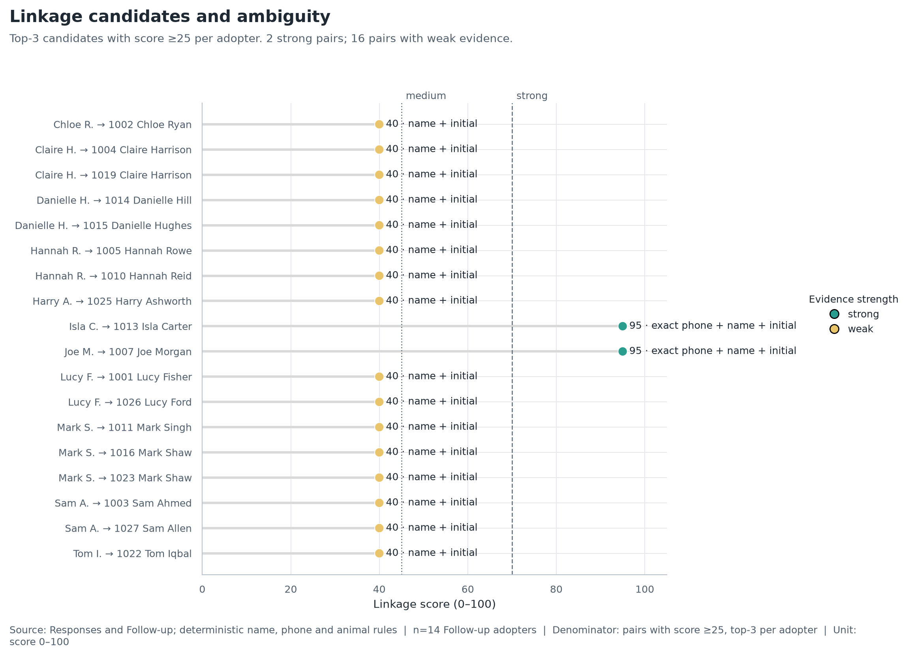

**Pergunta:** Quem são os candidatos e onde a identidade é ambígua?

**Leitura:** Isla C. e Joe M. resolvem por telefone exato; Mark S. resolve para Mark Shaw (1016/1023), não Mark Singh; Claire H., Lucy F., Danielle H. e Hannah R. resolvem-se pela regra de estado/duplicação/pets. Sam A. fica ambíguo.

**n / denominador:** 14 adopters do Follow-up / pares com score ≥25, top-3 por adopter.

**Fonte:** Responses e Follow-up; regras determinísticas de nome, telefone, estado e animal.

**Ressalva:** O score é triagem; a resolução usa clusters de pessoa e estado, não só o score.

### F09 — Scores de screening e desfecho por candidatura

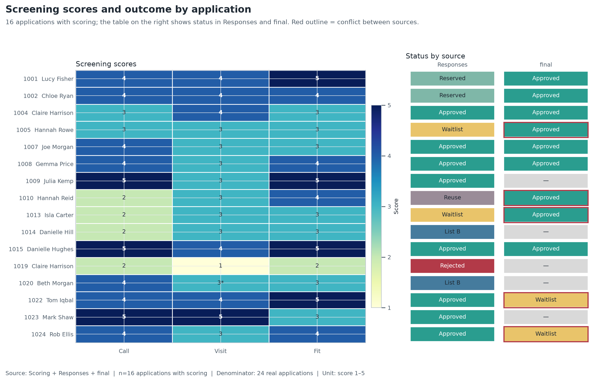

**Pergunta:** Como Call, Visit e Fit se distribuem e se ligam ao desfecho?

**Leitura:** Scores altos aparecem em candidaturas aprovadas, mas também em waitlist e rejeitadas; o desfecho não é explicado por um único sinal.

**n / denominador:** 16 candidaturas com scoring / 24 candidaturas reais.

**Fonte:** Scoring + Responses + final.

**Ressalva:** Amostra pequena e sem follow-up completo; não inferir causalidade. * Visit de 1020 foi extraído do texto original.

### F10 — Cobertura do processo de adoção

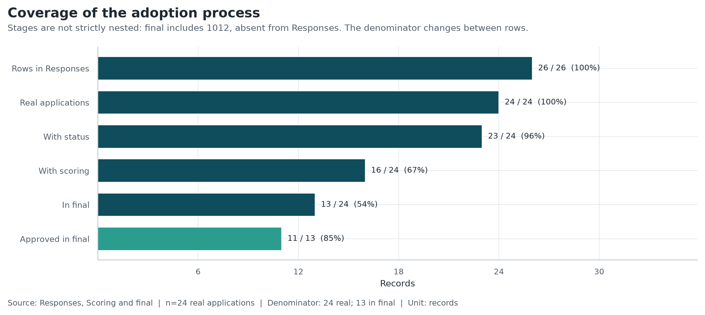

**Pergunta:** Onde o funil perde registos?

**Leitura:** 24 candidaturas reais (23 pessoas únicas), 16 com scoring, 13 em final e 11 aprovadas; o funil perde mais registos entre candidatura e scoring.

**n / denominador:** 24 candidaturas; 23 pessoas / 24 reais; 13 em final.

**Fonte:** Responses, Scoring e final.

**Ressalva:** Comparação de cobertura, não uma taxa de conversão entre etapas.

### F11 — O que o Follow-up observa

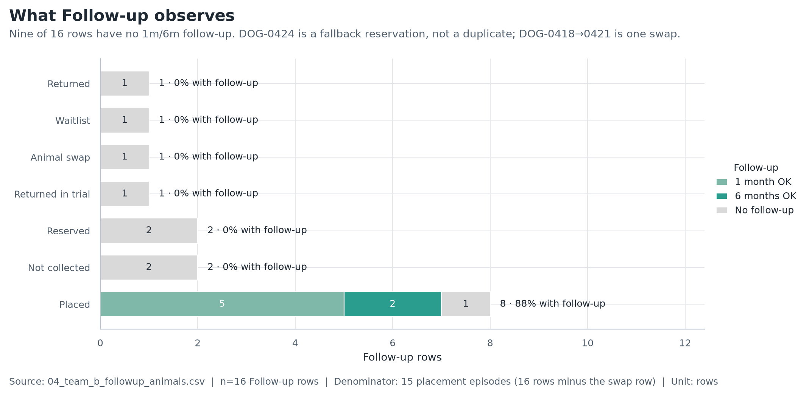

**Pergunta:** Que resultados e stages de follow-up existem?

**Leitura:** Só 'Handed over' tem follow-up 1m/6m; devoluções, não recolhas e reservas aparecem sem data de contacto. As 16 linhas são 15 episódios: DOG-0424 é fallback e DOG-0418 → DOG-0421 é uma troca, não duplicações.

**n / denominador:** 16 linhas do Follow-up / 15 episódios de placement (16 linhas menos a linha de troca).

**Fonte:** 04_team_b_followup_animals.csv.

**Ressalva:** A lista parece corrente, não uma coorte fechada; o ano não está registado.

### F12 — Prioridade das anomalias semânticas

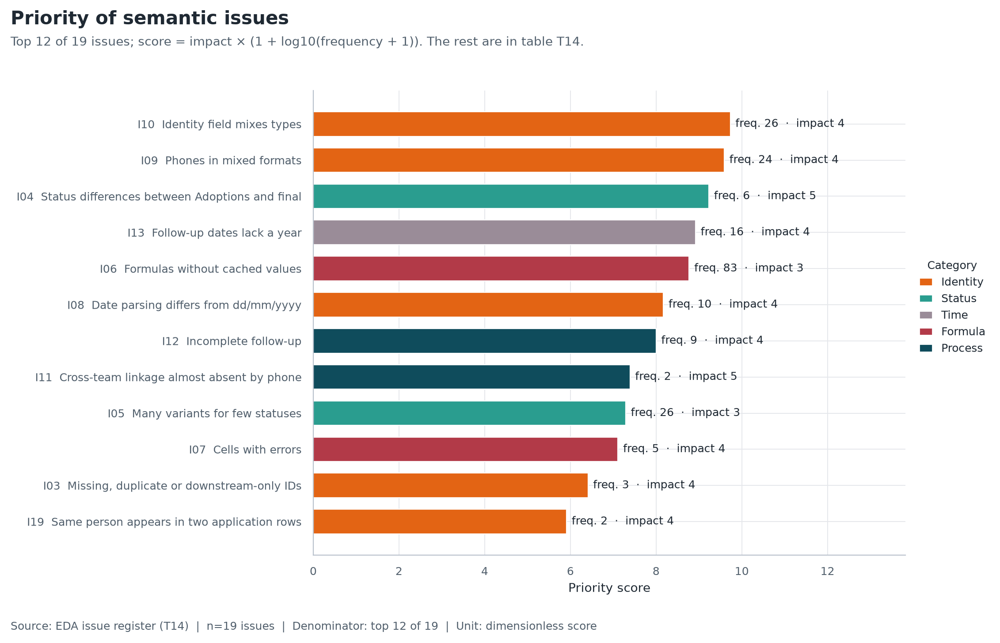

**Pergunta:** Que anomalias têm maior impacto operacional?

**Leitura:** Identidade, diferenças de estado e datas sem ano dominam a prioridade; não são apenas 'células sujas', são falhas de modelo de dados. Depois da resolução determinística, a ambiguidade de linkage resume-se a Sam A. e aos 3 adopters sem candidato.

**n / denominador:** 19 anomalias / top 12 de 19.

**Fonte:** Registo de anomalias da EDA (T14).

**Ressalva:** O score é uma heurística de priorização, não uma medida de risco.

## 4. Tabelas de referência

Todas as tabelas estão em `outputs/tables/` e consolidadas em `outputs/tables/eda_tables.xlsx`.

### KPIs e reconciliação

| metric | value | unit | definition |
| --- | --- | --- | --- |
| response_rows | 26 | rows | All rows, including tests. |
| test_rows | 2 | rows | IDs 1000 and 1017. |
| real_applications | 24 | applications | Excludes test rows. |
| unique_people | 23 | people | Person clusters; 1016 and 1023 are the same Mark Shaw. |
| duplicate_applications | 1 | applications | Real applications minus unique people. |
| with_status | 23 | applications | 1027 has no status. |
| with_scoring | 16 | applications | Scoring sheet. |
| in_final | 13 | applications | final sheet; includes 1012. |
| approved_in_final | 11 | applications | Status Approved. |
| waitlist_in_final | 2 | applications | Status Waitlist. |
| status_conflicts | 6 | applications | Responses vs final, raw differences. |
| status_progressions | 4 | applications | Waitlist/Reuse/Visit → Approved. |
| status_reversals | 2 | applications | Approved → Waitlist. |
| followup_rows | 16 | rows | Follow-up list. |
| followup_adopters | 14 | adopters | Abbreviated name. |
| followup_animals | 15 | codes | DOG-0424 is a fallback reservation, not a duplicate. |
| followup_episodes | 15 | episodes | Rows minus the intermediate swap row. |
| followup_without_record | 9 | rows | No 1m/6m. |
| returns | 2 | rows | Returned + Returned (trial). |
| phone_exact | 2 | adopters | Exact phone after normalisation. |
| name_candidates | 11 | adopters | Name + initial. |
| linkage_resolved | 10 | adopters | Deterministic exact phone, status, duplicate or household-pet rule. |
| no_candidate | 3 | adopters | No name/phone candidate. |
| ambiguous | 1 | adopters | More than one identity candidate; no deterministic tie-break. |
| dob_mismatch | 10 | records | dob_clean differs from dd/mm/yyyy parsing. |

| metric | summary_formula | recomputed | difference | note |
| --- | --- | --- | --- | --- |
| Total requests | 26 | 24 | -2 | COUNTA counts 26 IDs, including 2 test rows; real = 24 applications (23 unique people; 1016/1023 are the same person). |
| Approved | 9 | 10 | 1 | Approved* counts 7 Approved + 2 reserved; misses 'Aproved'. Canonical = 10 applications. |
| Waitlist | 5 | 5 | 0 | Matches after case/whitespace normalisation. |
| List B | 1 | 3 | 2 | Formula only catches exact 'List B'; there are 3 variants. |
| Rejected | 3 | 3 | 0 | Matches; includes 'Rejected - previous return'. |
| Reuse | 1 | 1 | 0 | Matches. |
| Home visit | 1 | 16 | 15 | Formula counts the 'visit' status; there are 16 visits with a score. |
| Reserved | 2 | 2 | 0 | Matches 'Approved - reserved'. |
| Sum | 20 | 24 | 4 | Formula sums to 20; the real total has 24 applications (23 people), including 3 with no status. |

### Sinais de screening e desfecho

| final_group | applications | call_mean | visit_mean | fit_mean | score_mean | application_ids |
| --- | --- | --- | --- | --- | --- | --- |
| Approved | 9 | 3.44 | 3.44 | 3.78 | 3.56 | 1001, 1002, 1004, 1005, 1007, 1008, 1010, 1013, 1015 |
| Waitlist | 2 | 4 | 3.5 | 4.5 | 4 | 1022, 1024 |
| Not in final | 5 | 3.6 | 3 | 3.2 | 3.27 | 1009, 1014, 1019, 1020, 1023 |

Os scores médios não separam de forma limpa aprovados, waitlist e candidaturas sem `final`. Com 16 casos e estados sobrepostos, isto é uma leitura descritiva, não um teste preditivo.

### Linkage entre equipas

| adopter | best_id | best_name | best_status | best_final_status | confidence | ambiguity | resolution | same_person_ids | alternatives |
| --- | --- | --- | --- | --- | --- | --- | --- | --- | --- |
| Pam Q. |  |  |  |  | no match | no candidate | no candidate |  |  |
| Hannah R. | 1005 | Hannah Rowe | Waitlist | approved | medium | resolved | household pets |  | 1010 Hannah Reid (40, Reuse / final approved) |
| Sam A. |  |  |  |  | ambiguous | ambiguous | ambiguous |  | 1003 Sam Ahmed (40, Rejected); 1027 Sam Allen (40, Unknown) |
| Isla C. | 1013 | Isla Carter | Waitlist | approved | strong | resolved | exact phone |  |  |
| Oscar S. |  |  |  |  | no match | no candidate | no candidate |  |  |
| Chloe R. | 1002 | Chloe Ryan | Approved — reserved | approved | medium | resolved | positive candidate |  |  |
| Tom I. | 1022 | Tom Iqbal | Approved | waitlist | medium | resolved | positive candidate |  |  |
| Lucy F. | 1001 | Lucy Fisher | Approved — reserved | approved | medium | resolved | positive candidate |  | 1026 Lucy Ford (40, List B) |
| Claire H. | 1004 | Claire Harrison | Approved | approved | medium | resolved | positive candidate |  | 1019 Claire Harrison (40, Rejected) |
| Joe M. | 1007 | Joe Morgan | Approved | approved | strong | resolved | exact phone |  |  |
| Mark S. | 1016 | Mark Shaw | Visit | approved | medium | resolved | person duplicate | 1016, 1023 | 1011 Mark Singh (40, Rejected) |
| Danielle H. | 1015 | Danielle Hughes | Approved | approved | medium | resolved | positive candidate |  | 1014 Danielle Hill (40, List B) |
| Harry A. | 1025 | Harry Ashworth | Waitlist |  | weak | resolved | unique name |  |  |
| Ivy C. |  |  |  |  | no match | no candidate | no candidate |  |  |

A coluna `resolution` mostra a regra que decidiu o par; `alternatives` preserva os candidatos descartados com o respetivo estado. Sam A. fica sem `best_id` de propósito: 1003 (Rejected) e 1027 (sem estado) não têm evidência suficiente para um merge automático.

### Anomalias prioritárias

| issue_id | category | issue | frequency | impact | priority_score | treatment |
| --- | --- | --- | --- | --- | --- | --- |
| I10 | Identity | Identity field mixes types | 26 | 4 | 9.73 | Separate type and value; use adopter_id when available. |
| I09 | Identity | Phones in mixed formats | 24 | 4 | 9.59 | Normalise to E.164 and separate mobile/landline. |
| I04 | Status | Status differences between Adoptions and final | 6 | 5 | 9.23 | Status per team + timestamp, not a single mutable field. |
| I13 | Time | Follow-up dates lack a year | 16 | 4 | 8.92 | Store a full timestamp with year and timezone. |
| I06 | Formula | Formulas without cached values | 83 | 3 | 8.77 | Do not read KPIs from formulas; recompute in the pipeline. |
| I08 | Identity | Date parsing differs from dd/mm/yyyy | 10 | 4 | 8.17 | Explicit parsing with dayfirst=True, plus a cross-record audit before using DOB as a key. |
| I12 | Process | Incomplete follow-up | 9 | 4 | 8 | Status and date fields per contact; distinguish not applicable from unknown. |
| I11 | Process | Cross-team linkage almost absent by phone | 2 | 5 | 7.39 | Add an application/person ID to the Follow-up export; keep a human-review seam for the residual. |
| I05 | Status | Many variants for few statuses | 26 | 3 | 7.29 | Crosswalk + form validation. |
| I07 | Formula | Cells with errors | 5 | 4 | 7.11 | Fixed IDs, validation and key-based formulas, not positional ones. |
| I03 | Identity | Missing, duplicate or downstream-only IDs | 3 | 4 | 6.41 | Immutable person/application IDs and an event log by source. |
| I19 | Identity | Same person appears in two application rows | 2 | 4 | 5.91 | person_id + application_id; allow several applications per person and resolve to one person. |

A lista completa, com evidência e denominador, está em `T14_issue_register.csv`.

## 5. Perguntas para as equipas

1. **O que significa `Ref`?** É uma referência de revisão, um lote ou outra chave? Porque falta em quase todos os registos?
2. **Quem atualiza `final` e quando?** É uma lista de placements, de aprovações ou de decisões de chamada?
3. **O Follow-up é a coorte completa de placements** ou apenas os casos que a equipa estava a acompanhar nessa semana?
4. **Que ano têm as datas `updated`?** Sem ano, não é possível calcular tempo até devolução ou follow-up.
5. **1012 foi criado diretamente em final?** Que outros registos podem existir apenas numa das listas?
6. **Há agregados familiares?** Dois adopters podem partilhar telefone, morada ou animal; o modelo atual não representa isso.
7. **1016 e 1023 são a mesma pessoa ou duas candidaturas?** Os dados dizem que sim (adopter no., telefone e DOB); confirmar se foi correção ou re-submissão.
8. **Sam A. é 1003, 1027 ou outra coorte?** 1003 é Rejected - previous return; 1027 não tem estado. As evidências não permitem decidir sem confirmação humana.
9. **Quem valida os candidatos de linkage?** Mostrar evidência, score e alternativas; nunca fazer merge automático de identidades.
10. **O que é “List B” e “Reuse”** no processo real? São estados, filas ou resultados?

## 6. Implicações para o protótipo

- Criar `person_id` e `household_id` estáveis; nomes, telefones e documentos passam a ser atributos, não chaves. O caso 1016/1023 mostra que uma pessoa pode ter mais de uma candidatura.
- Guardar eventos por fonte (`application`, `screening`, `decision`, `placement`, `followup`) com timestamp e autor.
- Separar estado de candidatura, estado de placement e estado de follow-up; não sobrescrever o estado da outra equipa.
- Não calcular KPIs a partir de fórmulas da sheet; recalcular na pipeline e comparar com o valor apresentado.
- Normalizar telefone para E.164, datas para ISO 8601 e listas de estado fechadas no formulário.
- Tratar o linkage como triagem: aplicar primeiro regras determinísticas (adopter no., telefone, DOB, estado, pets do agregado) e só depois revisão humana. O Mark S. → Mark Shaw é resolúvel sem perguntar a ninguém; Sam A. não é.
- Registar a coorte de Follow-up com `placement_id`, data de entrega, contacto e resultado; distinguir “sem follow-up” de “sem contacto” e não contar a linha intermédia de uma troca como placement.

## 7. Limitações

- As contagens de Follow-up são descritivas; não há denominador de placements elegíveis.
- O linkage usa nome abreviado, telefone e animal; não valida morada, email nem documento. A resolução determinística cobre 10 de 14 adopters, mas Harry A. é só uma correspondência única de nome; Sam A. e os 3 sem candidato continuam sem confirmação.
- A troca `DOG-0418 → DOG-0421` e a reutilização `DOG-0424` mostram que o animal também não é uma chave estável; são eventos operacionais, não duplicações.
- O parser de datas foi auditado com a regra dd/mm/yyyy do formulário; 1016 é confirmado pelo duplicado 1023, mas as outras nove datas divergentes continuam por auditar.
- Não foi feita inferência estatística nem modelação preditiva; a amostra e a qualidade dos outcomes não o justificam.

## 8. Ficheiros gerados

- Figuras: 12 PNG em `outputs/figures/`.
- Tabelas: 27 CSV em `outputs/tables/`.
- Manifesto de figuras: `outputs/figure_manifest.csv`.
- QA visual: `outputs/tables/figure_qa.csv`.
- Manifesto de execução: `outputs/run_manifest.json`.

### Tabelas

- `T01_inventory` — 6 linhas · `outputs/tables/T01_inventory.csv`
- `T02_column_profile` — 55 linhas · `outputs/tables/T02_column_profile.csv`
- `T03_missingness` — 30 linhas · `outputs/tables/T03_missingness.csv`
- `T04_value_variants` — 158 linhas · `outputs/tables/T04_value_variants.csv`
- `T05_duplicates` — 14 linhas · `outputs/tables/T05_duplicates.csv`
- `T06_formula_audit` — 88 linhas · `outputs/tables/T06_formula_audit.csv`
- `T07_formula_summary` — 4 linhas · `outputs/tables/T07_formula_summary.csv`
- `T08_dob_audit` — 26 linhas · `outputs/tables/T08_dob_audit.csv`
- `T09_updated_audit` — 16 linhas · `outputs/tables/T09_updated_audit.csv`
- `T10_candidate_pairs` — 36 linhas · `outputs/tables/T10_candidate_pairs.csv`
- `T11_adopter_links` — 14 linhas · `outputs/tables/T11_adopter_links.csv`
- `T12_reconciliation` — 27 linhas · `outputs/tables/T12_reconciliation.csv`
- `T13_animal_identity` — 15 linhas · `outputs/tables/T13_animal_identity.csv`
- `T14_issue_register` — 19 linhas · `outputs/tables/T14_issue_register.csv`
- `T15_screening_outcomes` — 16 linhas · `outputs/tables/T15_screening_outcomes.csv`
- `T16_followup_summary` — 7 linhas · `outputs/tables/T16_followup_summary.csv`
- `T17_kpis` — 26 linhas · `outputs/tables/T17_kpis.csv`
- `T18_summary_reconciliation` — 9 linhas · `outputs/tables/T18_summary_reconciliation.csv`
- `T19_status_crosswalk` — 22 linhas · `outputs/tables/T19_status_crosswalk.csv`
- `T20_stage_coverage` — 6 linhas · `outputs/tables/T20_stage_coverage.csv`
- `T21_format_counts` — 17 linhas · `outputs/tables/T21_format_counts.csv`
- `T22_time_series` — 5 linhas · `outputs/tables/T22_time_series.csv`
- `T23_status_variants` — 13 linhas · `outputs/tables/T23_status_variants.csv`
- `T24_evidence_summary` — 14 linhas · `outputs/tables/T24_evidence_summary.csv`
- `T25_animal_matches` — 18 linhas · `outputs/tables/T25_animal_matches.csv`
- `T26_screening_by_outcome` — 3 linhas · `outputs/tables/T26_screening_by_outcome.csv`
- `T27_figure_qa` — 12 linhas · `outputs/tables/T27_figure_qa.csv`

---

